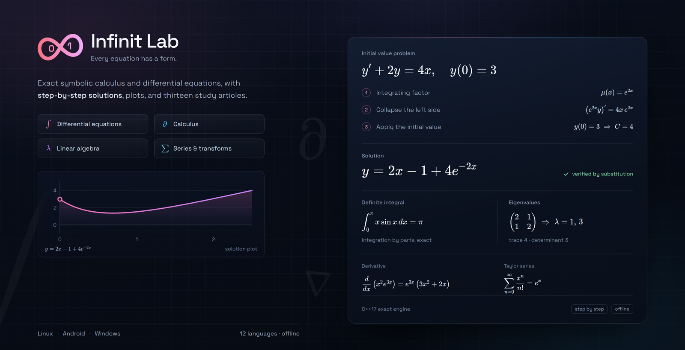

<p align="center">
  
</p>

<h1 align="center">Infinit Lab</h1>

<p align="center">
  <a href="https://github.com/amirx011/infinit/releases/latest"></a>
  
  
  
</p>

Infinit Lab is a desktop and mobile workbench for differential equations and calculus. It solves a problem symbolically in a native C++17 engine, then shows the answer together with the steps that produced it: the family it recognised, the substitution it used, and the check that puts the result back into the equation. There is no hidden numeric guess behind a symbolic answer; when no exact method fits, the app says so and offers a clearly labelled RK4 approximation instead.

The same engine and the same interface run on Linux, Windows and Android.

## What it does

**Differential equations.** Separable, exact, first-order linear, Bernoulli, homogeneous, integrating factor, Riccati, Clairaut, Lagrange and linear substitution equations; constant-coefficient equations of second and higher order; direct integration; and order reduction for equations missing `x` or `y`. Every family the equation belongs to is listed, with the derivation, the potential function and the substitution.

**Calculus.** Derivatives up to order 10, indefinite integrals through tables, substitution, parts, rational functions and trigonometric powers, Taylor and Maclaurin polynomials with the Lagrange remainder, area between curves, volumes of revolution, arc length, partial derivatives, gradients, Laplacian and directional derivatives.

**Applications and series.** Monotonicity, concavity, inflection points and asymptotes, tangent and normal lines, extrema on a closed interval, related rates, the mean value theorems, L'Hôpital's rule and convergence tests with exact sums where a closed form exists.

**Linear algebra and geometry.** Wronskians, exact determinants, traces, characteristic polynomials, eigenvalues, eigenvectors, inverses and diagonalisability for matrices up to 3x3, envelopes, and orthogonal and oblique trajectories.

**Workbenches.** Linear systems and phase portraits, critical points and stability, Lotka-Volterra, Laplace and inverse Laplace transforms, discontinuous forcing and impulses, convolution, Fourier series and transform, Euler, Heun, RK4 and Adams-Bashforth methods with error and convergence, growth and decay, Newton cooling, logistic growth, mixing, spring-mass systems, damped oscillation, circuits, free fall, and a partial differential equations group covering transport, characteristics, classification, separation of variables, and the heat, wave and Laplace equations on a rectangle.

**Study library.** Thirteen self-contained articles with key ideas, the full explanation, two worked examples and a list of common mistakes. Each article links to the workbench that puts the method to use.

**Interface.** Dark, light and system themes with six accent palettes, high-contrast mode, reduced motion and four text sizes. Twelve languages, with Persian and Arabic switching the whole layout to right-to-left. Keyboard shortcuts and a command palette on desktop, touch-first layout on phones. Fully offline: preferences stay on the device and nothing is sent anywhere.

## Install

Download the files for your platform from the [latest release](https://github.com/amirx011/infinit/releases/latest).

### Linux

Three packages are published, all with the same build.

```bash
tar xzf infinit-lab-<version>-linux-x64.tar.gz   # portable folder
sudo dnf install infinit-lab-<version>-1.x86_64.rpm   # Fedora, RHEL, openSUSE
chmod +x infinit-lab-<version>-x86_64.AppImage && ./infinit-lab-<version>-x86_64.AppImage
```

The tarball is self-contained apart from the GTK 3 runtime. The RPM adds `/usr/bin/infinit`, a menu entry and a desktop icon, so it can be started from the application menu. The AppImage is a single file that needs no installation.

Install the runtime once if it is missing: `sudo apt install libgtk-3-0` on Debian or Ubuntu, `sudo dnf install gtk3` on Fedora.

To put the tarball on your `PATH` with a menu entry, without root:

```bash
./scripts/install_linux.sh infinit-lab-<version>-linux-x64.tar.gz
```

This writes `~/.local/bin/infinit` and an **Infinit Lab** entry. Remove it with `./scripts/uninstall_linux.sh`; add `--purge` to delete the saved settings too.

### Windows

Run `InfinitLab-<version>-Setup.exe` and follow the wizard. It does not need administrator rights and adds Start menu and optional desktop shortcuts.

The portable zip needs no installation: unpack it anywhere and keep `odecore.dll` next to `infinit.exe`. Settings live in `%APPDATA%\infinit\settings.json`.

### Android

Open `infinit-lab-<version>-android.apk` on the phone and allow the installation when the file manager asks. It is a universal build: the native engine for 64-bit ARM, 32-bit ARM and x86_64 travels inside, so the same file installs on phones, tablets, Chromebooks and emulators. With a connected device:

```bash
adb install -r infinit-lab-<version>-android.apk
```

There is also one file per phone architecture, for a smaller download:

| File | Device |
|---|---|
| `infinit-lab-<version>-android-arm64-v8a.apk` | Current phones and tablets |
| `infinit-lab-<version>-android-armeabi-v7a.apk` | Older 32-bit phones |
| `infinit-lab-<version>-android-x86_64.apk` | Emulators and Chromebooks |

Android 7.0 or newer.

## Build from source

You need Flutter 3.47.8 or newer with Dart 3.13.7 or newer, CMake 3.16 or newer, and a C++17 compiler. Linux desktop builds also need `clang`, `ninja`, `pkg-config` and the GTK 3 development files; Android builds need the Android SDK and NDK; Windows builds need Visual Studio 2022 C++ tools and Inno Setup. The Python tests use `sympy` and `pytest`.

```bash
./scripts/build_linux.sh          # Linux bundle
./scripts/build_android.sh        # universal Android APK
powershell -File scripts\build_windows.ps1   # Windows app and installer
```

Linux needs a local GTK sysroot when the distribution ships only the runtime: `./scripts/setup_gtk_sysroot.sh` builds one without root access. Android release APKs are signed with `app/android/infinit-release.jks` through `app/android/key.properties`; both files are ignored by Git, and `scripts/verify_apk_signature.sh` checks the result.

Run the whole test suite with `./scripts/run_tests.sh`.

## License

Apache License 2.0. See [LICENSE](LICENSE).

Copyright 2026 Infinit Lab contributors.
